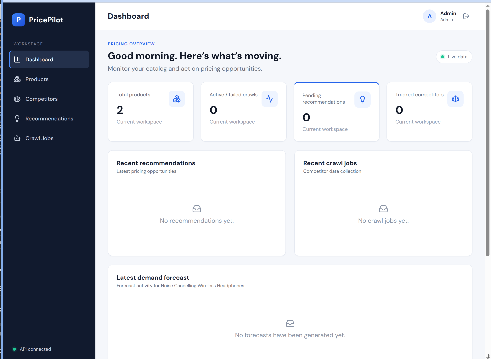
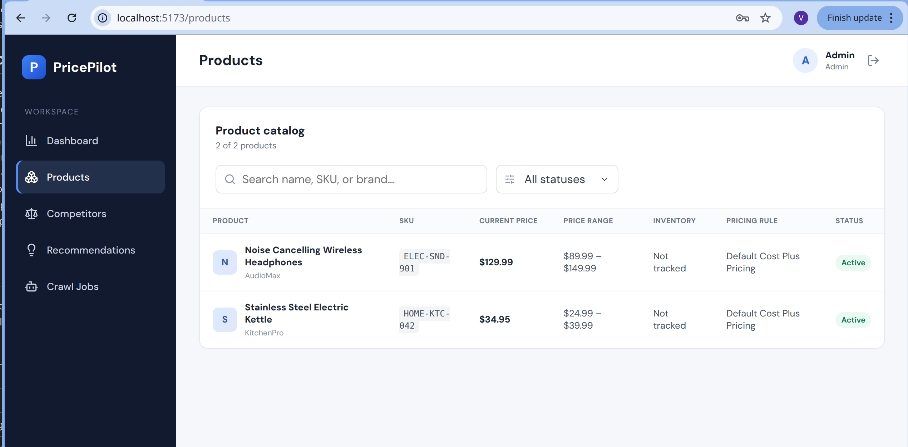
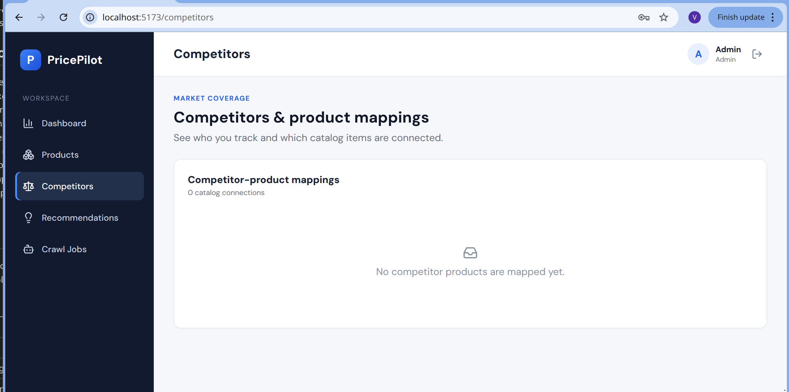
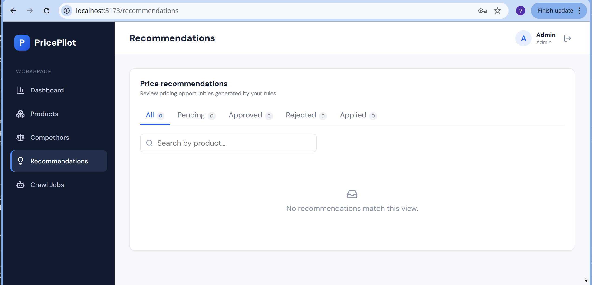
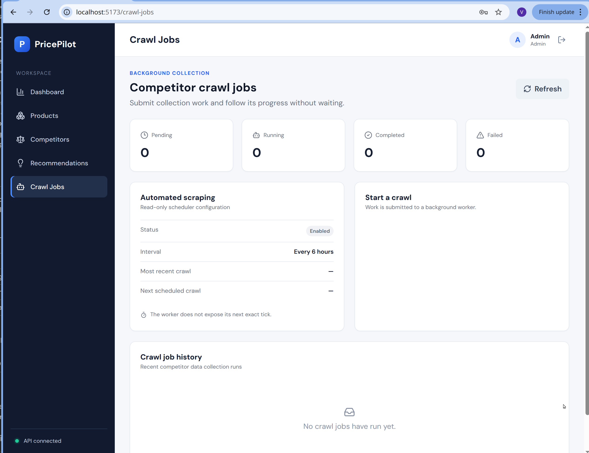

# Pricing Intelligence Platform

A full-stack pricing intelligence platform that monitors competitor prices, forecasts product demand, and combines cost, inventory, demand, and market signals to generate price recommendations. Recommendations follow an approval workflow before price changes are applied and recorded for auditing.

## Key Features

- Scheduled competitor-price crawling with Playwright and Celery
- Demand forecasting with ridge regression and a moving-average baseline
- Dynamic price recommendation for revenue optimization
- JWT authentication and role-based access control
- Redis-backed caching and Celery task queuing
- Responsive React dashboards

## Tech Stack

**Backend:** Python, FastAPI, SQLAlchemy, PostgreSQL, Redis, Celery, Playwright, scikit-learn, Pydantic

**Frontend:** React, TypeScript

**Infrastructure and testing:** Docker, Docker Compose, Alembic, pytest

## Core Workflow

1. A user or scheduled task submits competitor crawl jobs.
2. A Celery worker loads rendered product pages and stores new competitor-price observations.
3. Historical demand is evaluated using ridge regression and a moving-average baseline; the lower-error method produces future forecasts.
4. The recommendation engine combines the assigned pricing rule with available cost, inventory, demand, and competitor inputs.
5. An approver or administrator approves or rejects each pending recommendation.
6. Applying an approved recommendation updates the product price in one transaction.
7. The previous price, new price, reason, recommendation, and actor are recorded in product price history.

## Screenshots

### Main dashboard



### Product catalog



### Competitor pricing



### Price recommendations



### Crawl jobs




The database model is documented in [docs/database-erd.md](docs/database-erd.md).

## Local Development

### Prerequisites

- Docker Engine with Docker Compose, or Python 3.12 plus local PostgreSQL and Redis
- Node.js 20+ and npm

### Clone and configure

```bash
git clone <repository-url>
cd pricing-intelligence-platform
cp backend/.env.example backend/.env
cp frontend/.env.example frontend/.env
```

Replace the JWT placeholder in `backend/.env` with a local secret. Do not commit `.env` files.

### Backend with Docker Compose

The Compose stack runs PostgreSQL, Redis, migrations, FastAPI, a Celery worker, and Celery Beat:

```bash
cd backend
docker compose up --build
```

Create an administrator in a second terminal:

```bash
cd backend
docker compose exec api python create_admin.py
```

The API is available at <http://localhost:8000>, interactive API documentation at <http://localhost:8000/docs>, and health status at <http://localhost:8000/health>.

### Frontend

With the API running:

```bash
cd frontend
npm install
npm run dev
```

Open <http://localhost:5173>. Vite proxies `/api` to `http://localhost:8000` during local development. Set `VITE_API_URL` when the API is hosted elsewhere.

## Environment Variables

Backend configuration is loaded from `backend/.env` through Pydantic settings. See [backend/.env.example](backend/.env.example) for safe development placeholders.

| Variable | Purpose |
| --- | --- |
| `DATABASE_URL` | SQLAlchemy PostgreSQL connection URL |
| `REDIS_URL` | Application cache connection URL |
| `CELERY_BROKER_URL` | Celery task broker URL |
| `CELERY_RESULT_BACKEND` | Celery result backend URL |
| `JWT_SECRET_KEY` | JWT signing secret; replace the example value |
| `JWT_ALGORITHM` | JWT signing algorithm |
| `JWT_DEFAULT_EXP_MINUTES` | Access-token lifetime |
| `CORS_ORIGINS` | Comma-separated allowed frontend origins |
| `COMPETITOR_CRAWL_SCHEDULE_SECONDS` | Scheduled crawl interval |
| `DEMAND_FORECAST_SCHEDULE_SECONDS` | Scheduled forecast refresh interval |
| `DEMAND_FORECAST_DEFAULT_HORIZON_DAYS` | Default generated forecast length |
| `DEMAND_FORECAST_MIN_HISTORY_DAYS` | Minimum observations required for training |
| `CRAWLER_*` | Browser timeouts, retries, pacing, and user agent |

Frontend configuration:

| Variable | Purpose |
| --- | --- |
| `VITE_API_URL` | API base URL; defaults to `/api` |

## Repository Structure

```text
pricing-intelligence-platform/
├── backend/
│   ├── alembic/          # Database migrations
│   ├── app/
│   │   ├── api/          # FastAPI routers
│   │   ├── crawlers/     # Playwright and parsing adapters
│   │   ├── crud/         # Persistence queries
│   │   ├── models/       # SQLAlchemy models
│   │   ├── schemas/      # Pydantic contracts
│   │   ├── services/     # Business logic and transactions
│   │   └── tasks/        # Celery tasks and schedule
│   └── tests/
├── frontend/
│   └── src/
│       ├── components/
│       ├── context/
│       ├── hooks/
│       ├── lib/
│       └── pages/
└── docs/                 # Database ERD sources and renderings
```

## Future Improvements

- Cloud deployment and continuous delivery
- More advanced pricing optimization and forecasting models
- AI features including AI pricing analyst, RAG over pricing documentation
