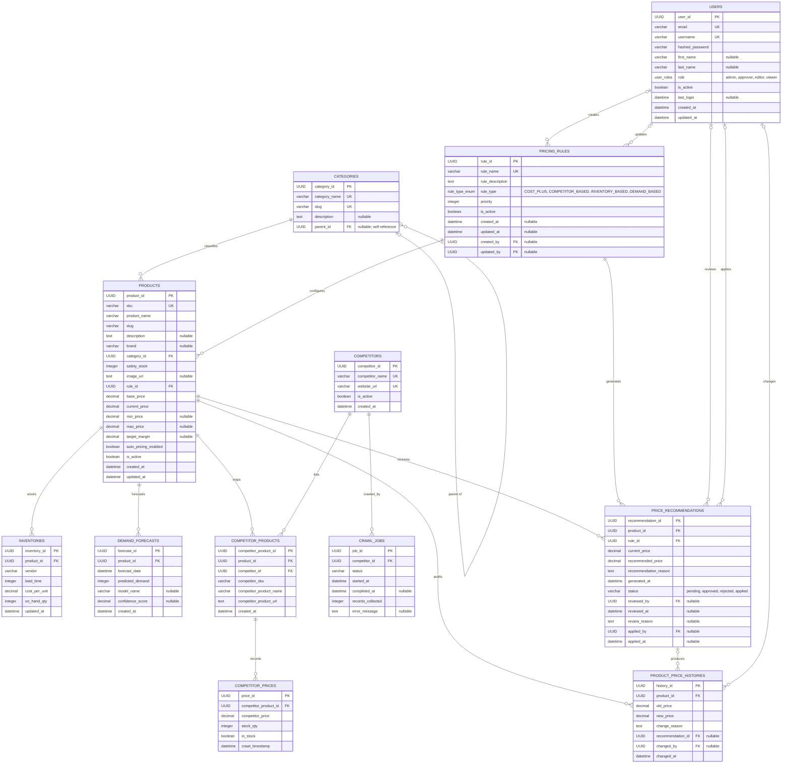
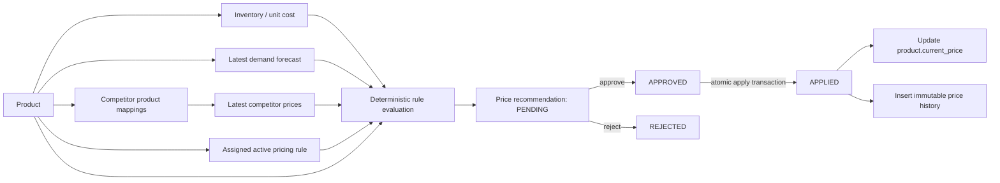

# Pricing Intelligence Platform — Database ERD

This diagram reflects the SQLAlchemy models in `backend/app/models` as of August 8, 2026.

Rendered reference files: [SVG](database-erd.svg) · [high-resolution PNG](database-erd.png) · [Graphviz source](database-erd.dot)

## Pricing workflow

## Constraints and implementation notes

- `competitor_products` is unique on `(product_id, competitor_id)`.
- `demand_forecasts` is unique on `(product_id, forecast_date, model_name)`.
- Categories cannot reference themselves directly (`category_id <> parent_id`).
- Product price history has no update or delete API and serves as immutable audit data.
- The application creates one history row when applying a recommendation, but `recommendation_id` is not unique in the physical schema, so the database itself permits multiple history rows for one recommendation.
- Recommendation review/application and their associated user relationships are nullable because deleting a user uses `ON DELETE SET NULL`.
- The application treats inventory as one record per product, but the database currently lacks a unique constraint on `inventories.product_id`; therefore the physical ERD shows one-to-many.
- Mermaid repeats the user-to-rule and user-to-recommendation relationship because each table contains separate actor columns (`created_by`/`updated_by` and `reviewed_by`/`applied_by`).

## Legend

- `PK`: primary key
- `FK`: foreign key
- `UK`: unique key
- `||`: exactly one
- `o|`: zero or one
- `o{`: zero or many
